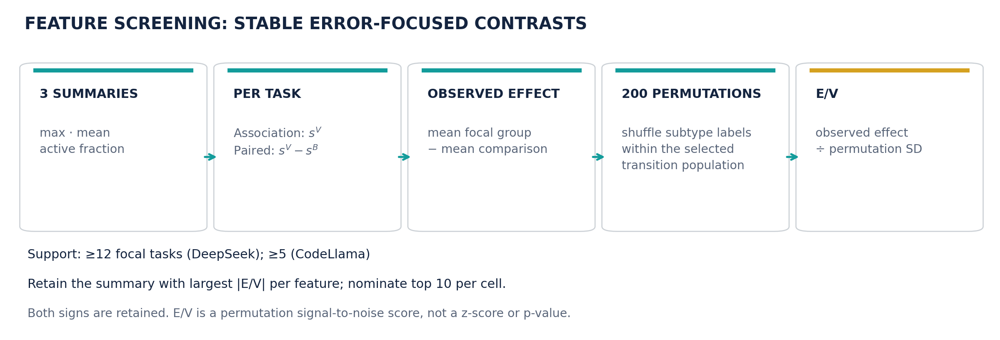
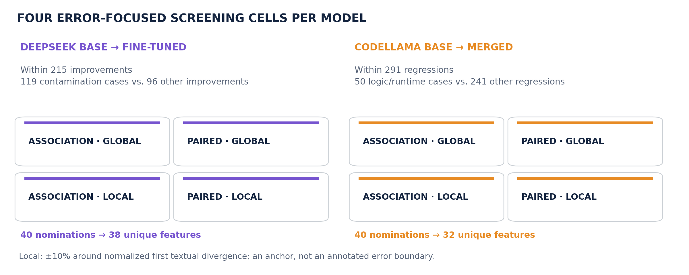

# Canonical DeepSeek 119-task reproducibility protocol

This version is the canonical **direct-intervention DeepSeek contamination study**, frozen on 2026-10-13. It replaces the earlier 80-task subset for this study. It does not replace the original paper-v1 release, the DSTK100 training artifact, or the separate CodeLlama study. All historical manifests and experiment directories remain unchanged.

The authoritative configuration is [manifest.json](manifest.json). [../../manifests/dstk100_119_v1.json](../../manifests/dstk100_119_v1.json) points to it. [checksums.json](checksums.json) identifies the exact published inputs, scripts, figures, results and compressed raw archive.

## Frozen experiment

1. Start with 215 BigCodeBench base-fail → fine-tuned-pass transitions.
2. Use **all 119** cases classified as generated test/import contamination as the focal population, compared with the remaining **96** improvements. No feature-activation requirement further filters these 119 cases. The classification is the existing exploratory taxonomy, not a newly validated annotation study.
3. Reuse the canonical step-10,000 DSTK100 checkpoint: layer 16, RMS-normalized same-text residuals, 16,384 latents, per-token ReLU + TopK-100. Inputs include evaluated code tokens only. Both generated texts are replayed through both models.
4. Screen association/paired × global/local using max, mean and active fraction. Association uses the shared latent summary on fine-tuned-generated text; paired uses that summary minus the one on base-generated text. Compute focal-minus-comparison effect, 200 label permutations, and effect divided by sample null SD. Retain the summary with largest absolute E/V per feature and cell, then top 10 per cell with support in at least 12 focal tasks. Both signs are retained. Forty nominations yield **38 unique candidates**.
5. Global includes all evaluated code tokens. Local uses the common character prefix of the extracted paired codes, divided by each text's length, mapped approximately to token position. Radius is `max(2, ceil(0.10*n_tokens))`, clipped at sequence boundaries. This anchor is textual divergence, not an annotated semantic error. Task order, metric order and permutation RNG seed 42 are retained; task summaries are stored in float16 before float32 effect calculations, matching the implemented screen.
6. Validate a fresh alpha-zero baseline: **119/119 raw completions match byte-for-byte; official passes 0/119**. The 39-task random-control extension independently matches 39/39 and passes 0/39.
7. Intervene continuously at the last token position of layer 16 on DeepSeek base, with its decoder branch. The nominated sign follows the strongest screening effect. This sign is a hypothesis, not evidence of a feature's universal causal meaning. In particular, the historical `specialized_enriched` label in an association table denotes a positive focal-vs-comparison contrast, not proof of model specificity.
8. Sweep all 38 candidates at |alpha|=3. Rank by official corrections, then absolute E/V, then feature ID. Freeze the five selected features for magnitudes 1,2,3,4,5; reuse their alpha-three outputs from the sweep.
9. Compare with the same prospectively sampled random latent IDs and signs: **15173 negative, 6023 positive, 605 positive**. Their 80 historical tasks are reused and the 39 additional tasks are generated at every magnitude. Merging checks disjoint task IDs, seeds, and exact extraction consistency with archived evaluations. No controls are resampled based on results.

Generation uses `temperature=0.2`, `top_p=0.95`, `max_new_tokens=512`, NF4, `paired_cached`, and the explicit input seed `1000 + 100*task_idx`. Evaluation uses the repository's extraction scripts and official BigCodeBench 0.1.5 subset evaluator. [metadata/runtime_versions.json](metadata/runtime_versions.json) records the installed generation environment. Model identifiers alone do not guarantee hardware-independent byte reproduction; the alpha-zero gate must pass again on the reproducing environment.

## Completed results

| Stage | Coverage | Result |
|---|---:|---:|
| Alpha-zero baseline | 119 tasks | 119 exact raw reproductions; 0 passes |
| Fixed-magnitude sweep | 38 × 119 | 174 feature–task corrections; 19 distinct tasks |
| Selected target curves | 5 × 119 × 5 doses | All 25 arms evaluated; alpha=3 reused |
| Random latent curves | 3 × 119 × 5 doses | All 15 arms evaluated; 80+39 provenance preserved |

The five selected features, ordered by their alpha-three results:

| Feature | Direction | Strongest nomination | E/V | Corrections (magnitude 3) | Corrections (magnitude 5) |
|---:|:---:|---|---:|---:|---:|
| 4810 | − | paired global | −14.57 | 12/119 | 14/119 |
| 2468 | − | paired local | −10.23 | 10/119 | 11/119 |
| 2621 | − | paired local | −9.55 | 8/119 | 10/119 |
| 10539 | − | paired local | −9.35 | 8/119 | 11/119 |
| 6895 | + | association global | +8.11 | 7/119 | 6/119 |

At |alpha|=5 the three random features correct **7, 6 and 6 /119**. Feature 4810 corrects twice as many tasks as the strongest of these three controls. This is an observed within-cohort comparison, not a corrected significance claim or evidence about every possible random feature. Task corrections overlap across features; 174 transitions are not 174 distinct tasks. Selection and intervention use the same cohort and one seed per task.

Machine-readable results: [results_summary.json](results_summary.json), [tables/screening_top10.json](tables/screening_top10.json), [tables/sweep.json](tables/sweep.json), [tables/target_curves.json](tables/target_curves.json), [tables/random_curves.json](tables/random_curves.json).

## Updated figures





Each figure is available as SVG (editable vector), PDF (paper), and PNG (slides). The combined two-panel paper figure is [screening_method_and_cells.pdf](../../presentation/figures/dstk100_119_v1/screening_method_and_cells.pdf). Regenerate these assets with `tools/build_dstk100_119_repro_package.py`; no generative image model is involved.

The CodeLlama panel describes its existing 50-vs-241 error-focused screen and 32 candidates. It does not expand the DeepSeek protocol to a new CodeLlama experiment.

## Restore and verify

Use a fresh checkout to preserve existing experiment directories. The compact [artifacts/canonical_outputs.tar.gz](artifacts/canonical_outputs.tar.gz) contains the completed generations, extracted code, official evaluation details, baseline audits, original screening tables, taxonomy, labels, training/capture metadata, and the original paired code inputs. It excludes checkpoint weights, activation arrays, credentials and unrelated experiment results. Only random-latent and baseline outputs are copied from the historical control run.

```bash
python tools/run_dstk100_119_protocol.py --stage verify
tar -xzf reproducibility/dstk100_119_v1/artifacts/canonical_outputs.tar.gz
```

`metadata/raw_artifact_checksums.json` records individual archived raw artifact hashes. `metadata/screening_input_audit.json` confirms that both recovered source-code sets match all 215 taxonomy improvement pairs exactly. Inputs and per-task seeds are also preserved directly in [inputs/cohort119.jsonl](inputs/cohort119.jsonl).

Large training artifacts retain their existing locations:

- Manifest: `manifests/dstk100_v1.json`.
- GCS: `gs://data-intelligence-bucket/tests/recatcher_crosscoder_humaneval/crosscoder_deepseek_base_finetuned_layer16_sametext_topk100_10k_v1/` (`checkpoint/`, `activations/`, `metadata/`). No new GCS publication or remote-object changes are implied by this Git release.
- Server checkpoint: `runs/crosscoder_deepseek_base_finetuned_layer16_same_text_topk100_v1/final.pt`.
- Server activations: `runs/same_text_activations/deepseek_base_finetuned_layer16_rms/`.

Verify the checkpoint against its SHA-256 in `manifest.json`; use only step 10,000. Restore the existing checkpoint and activation dataset into the documented paths before running GPU stages. The archive contains the capture manifest, but not the multi-gigabyte activation arrays or model weights.

## Reproduce the analysis and interventions

The following commands are for a future reproduction; publishing this package does not launch GPU experiments.

```bash
# Recompute the 119-vs-96 screen using restored paired code and activations.
.venv/bin/python tools/screen_focused_subtype_topk.py \
  --project dstk --dstk-cohort contamination119 --device cuda:0 \
  --permutations 200 --seed 42 \
  --results-root reproducibility/dstk100_119_v1/restored_results

# Fresh output directory; baseline must reproduce all raw outputs and remain 0/119.
.venv/bin/python tools/run_dstk100_119_protocol.py --stage baseline
.venv/bin/python tools/run_dstk100_119_protocol.py --stage sweep
.venv/bin/python tools/run_dstk100_119_protocol.py --stage curves
.venv/bin/python tools/run_dstk100_119_protocol.py --stage random
```

Use `CUDA_VISIBLE_DEVICES=<GPU UUID>` and `--device cuda:0` to select an available device. `--worker-index 0/1 --num-workers 2` shards non-baseline stages across two workers with disjoint arm outputs. Finish the baseline gate before starting shards. Interrupted arms recover atomically saved task outputs on restart.

`tools/run_dstk100_random_controls_119_extension.py` preserves the actual 80+39 extension execution. The general reproduction runner instead generates the frozen controls over all 119 tasks in a fresh directory. The dose-three sweep and target curves share their generated/evaluated outputs.

Historical manifests are provenance records, including their original selection metadata. The canonical scope and active comparisons are defined by this release's manifest. The current release supports direct intervention and random latent comparisons; its claims should remain within the recorded cohorts and outcomes.
